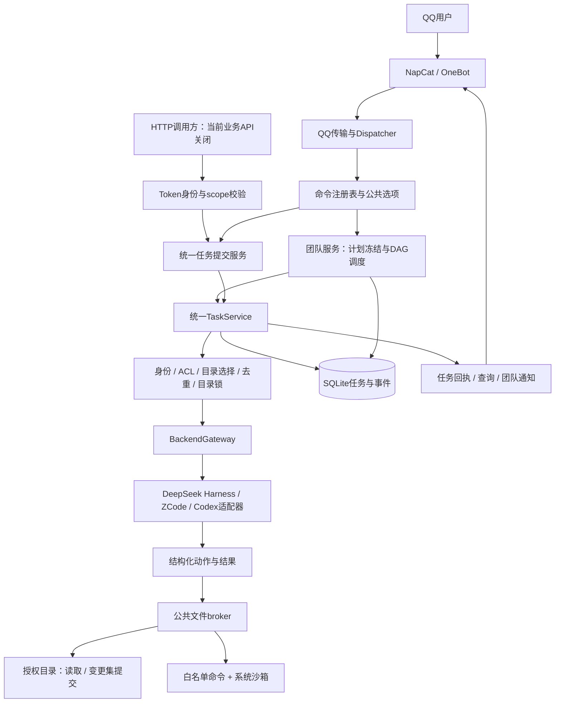

# QQ机器人项目总架构说明

更新日期：2026-10-12（Asia/Shanghai）。描述当前正式 `app/` 实现与已验收的运行方式；历史整改过程单独归档，不作为当前使用说明。

日常使用看[操作指南](操作指南.md)，逐项验收看[最终交付矩阵](统一控制台最终交付矩阵.md)，部署结果看项目最终交付（本机归档，未上传）。

## 1. 项目是什么

这是通过 QQ 调用多个编码/文本后端的统一任务控制台。用户用同一套命令选择后端、权限模式和项目目录，也可以把多个任务组成有依赖关系的团队流程。

当前实际启用三个入口：`deepseek`、`zcode`、`codex`，分别接 DeepSeek Harness、ZCode、Codex。OpenAI/GLM 独立 API 后端没有启用，不能把它们当成可用入口。DeepSeek Harness、ZCode、Codex 的认证方式各自独立，不能因为都运行在本机就认为都免费或都共用登录。

当前单实例、单 worker，QQ 通过 NapCat 的 OneBot WebSocket 接入。健康与状态接口监听 `127.0.0.1:8080`；业务 HTTP API 当前关闭。文件任务使用统一 broker，原生工具保持关闭。

核心架构已覆盖原 A01–A22 和五个场景。新增后端、模型或快捷命令有固定扩展入口；新增业务、改变权限、跨进程并发或存储设计仍需要相应开发和验收。

## 2. 总体数据流

图中归纳逻辑阶段，不代表每条请求都按同一线性顺序执行所有步骤。文本任务不创建文件工具；目录任务在各阶段及每次动作前重新核验权限。

## 3. 模块职责与源码地图

| 层 | 主要文件/目录 | 负责什么 |
|---|---|---|
| 启动与装配 | `app/main.py`、`app/config.py` | 配置优先级、FastAPI lifespan、服务注册、迁移、启动恢复和资源关闭 |
| QQ传输 | `app/transports/` | OneBot事件规范化、发送回执、连接与重连；不自行决定文件权限 |
| 命令与入口 | `app/commands/`、`app/routing/dispatcher.py`、`app/api/v1.py` | 注册表、公共语法、命令发现、入口身份和HTTP scope |
| 统一提交与任务 | `app/tasks/submission.py`、`service.py`、`store.py` | 目录选择后续跑、冻结执行规格、原子幂等登记、任务期限、执行记录和终态 |
| 后端接入 | `app/backends/`、`app/agents/` | 工厂注册、实际能力/模型目录、网关、协议适配、CLI生命周期 |
| 文件工作区 | `app/workspaces/` | 查找与绑定、路径约束、全入口目录锁、broker动作、变更/备份/冲突 |
| 权限与执行隔离 | `app/security/` | 用户/群与目录ACL、确认码、敏感路径、exec策略和系统沙箱 |
| 团队协作 | `app/workflows/` | 草稿、DAG、计划冻结、调度、直接依赖上下文、取消/重试和通知 |
| 普通聊天 | `app/storage/context_store.py` | 群/用户/Agent聊天上下文及裁剪；团队不混用聊天历史 |
| 交付验证 | `scripts/verify_final_delivery.py`、`tests/` | 回归、真实应用装配、临时HTTP/假OneBot、恢复与受限真实后端验收 |

## 4. 后端如何统一

三层概念分别是：Provider 的协议/认证、Backend 的具体适配器实例、Agent 的用户入口。目录能力不靠硬编码 Agent 名称决定。

`app/agents/base.py::AgentAdapter` 约定对话接口、模型与强度目录、配置状态、能力与错误。`app/backends/factory.py` 注册具体适配器；`BackendRegistry` 装配声明与实际能力；`BackendGateway` 选择文本、broker或获准的原生路径。

当前三个后端都走统一文件协议。模型可以请求 `list`、`read`、`search`、`propose_changes`、`run_command`，但由机器人判定和执行动作；模型自己声称“已经修改/执行”不是证据。

Codex 后端采用现有本机登录，通过适配器本次 argv 指定同源 HTTPS/SSE。没有修改全局用户配置、模型选择或权限 profile。DeepSeek/ZCode 的 broker 会话同样明确区分服务端动作请求与后端原生工具。

`enabled/configured` 说明装配与凭据条件；真实任务成功需要独立业务验证。当前三后端 text、文件行为及跨后端链的证据范围见最终交付报告，不把静态能力声明当作模型调用证明。

## 5. 命令与两类入口

八个规范命令族：`/task`、`/workspace`、`/agent`、`/team`、`/confirm`、`/access`、`/command`、`/help`。

语法、公共选项和帮助来自同一注册表。`outputs/命令清单.md` 由 `scripts/render_commands.py` 自动生成，不手工添加横幅或示例。

QQ与HTTP任务共用 `TaskSubmissionService` 和 `TaskService`。HTTP身份来自Token映射，正文不能伪造用户/管理员；团队HTTP动作复用现有团队语义，不另造调度器。API关闭时业务路径返回 `503 api_disabled`。

QQ去重覆盖单任务、all的各子任务和preset提交：含事件机器人身份、群、用户、message_id、提交目标与Agent。没有message_id时兼容不去重；不同message_id的同文仍是不同任务。HTTP与QQ使用分离的命名空间和方案/逻辑键归属。

`TaskStore.register_idempotent_task()` 由SQLite唯一索引和原子插入裁决；不能先查询再登记。重复投递返回已有任务，不自动重跑成功、失败、取消或中断终态。团队create/add等入口不能宣称具有同一套消息去重保证。

## 6. 文件与权限的真实边界

| 模式 | 可用行为 |
|---|---|
| text | 对话，不提供文件/命令工具 |
| read | 授权范围内列目录、搜索、读文本；不能写或执行Shell |
| edit | read加变更提交；受哈希冲突检查和逐文件备份保护 |
| exec | edit加受控本地命令；同时受白名单、参数校验、期限和系统沙箱限制 |

有效权限由群/用户授权、最具体目录ACL、请求/冻结步骤模式、后端实际能力和全局策略共同决定。父目录授权不能覆盖内部更严格的子目录；撤权在后续动作即时生效。机器人自身源码、配置/数据与凭据目录受保护。

模糊查找只在可搜索授权根内进行，有深度/条目/候选/耗时上限。即使只有一个候选也需要本人选择；确认绑定用户、群、请求、草稿版本与期限，消费一次。

`WorkspaceCoordinator` 让单任务和团队的相同/父子目录互斥，无关目录可并行。当前只允许单worker；跨进程锁未实现，不能把一个配置开关当作已有能力。

### 文件提交

`ChangeSet` 在规划阶段记录文件存在性和全文件哈希，提交前再次检查。漂移拒绝覆盖；覆盖/删除前在受控备份目录创建唯一备份；写入使用临时文件和原子替换。

每个文件分别记录状态。多文件任务不承诺整体事务回滚；取消或失败不会自动撤销已经应用的修改。原始读取可能截断，返回片段摘要与全文件版本摘要不能混淆。

### 本地命令

参数数组启动，不通过Shell解释。macOS使用 `sandbox-exec` 强制限读、限写、禁网，叠加敏感路径与提权/联网工具拒绝。当前只有任务目录、私有临时目录和字面量空设备 `/dev/null` 可写，受保护子树除外；解释器/运行库只读可用。凭据环境变量不透传给执行子进程。

平台缺少可验证隔离时明确禁用exec，不能退回裸执行。解释器PATH使用项目venv让已安装pytest可用，不因此开放机器人源码或配置。

## 7. 任务与团队生命周期

单任务会记录排队、目录待选/操作待确认、运行和终态。终态包括 succeeded、no_change、failed、cancelled、interrupted；文件任务是否成功由服务端动作和提交/命令回执判断。查看实际变化和exec退出码仍是必要步骤，不能仅看自然语言答复。

团队流程：create草稿 → add/remove步骤 → plan核对 → run冻结 → 按DAG调度 → status/result。冻结内容包括backend/model/effort/mode/规范目录；之后改默认或目录绑定不改变这一轮。

每步只收到总目标、本步指令、直接依赖的成功结果；上游文本是数据，不能提高权限。团队不读取/写入普通聊天历史。

取消保留已有结果和文件副作用。失败/中断重试复用可验证的成功结果；目录漂移或失败exec/部分写入要经过风险核查，必要时本人确认；取消任务不能重试。

## 8. 持久化与恢复

当前数据库为 `data/bot.db`，同一SQLite存储任务、事件、文件变更、默认/绑定、团队草稿和运行记录，以及聊天上下文。确认码为内存状态，不跨进程恢复。

配置 `schema_version=2` 与数据库 `schema_meta=3` 是不同含义，不要求数字相等。任务表保留 operation/action_counts，并包含幂等方案 key_scheme/logical_key 等字段。迁移检查已有结构再补表/列，可重复执行；不通过改版本数字假装恢复旧构建。

启动将未完成业务标记interrupted，不自动调用模型继续执行；旧确认失效。运行中备份必须用SQLite backup API包含WAL已提交内容，不能只复制主文件。

代码回退与数据库恢复是两种动作。当前有已知冻结版本和一致性恢复点；数据库恢复需单独评估备份之后的新业务，不能自动覆盖。历史事故前确切构建身份与上下文清空来源仍未确定，保留历史边界。

## 9. 当前部署与已验证范围

当前运行方式是项目venv启动 `app.main`，单实例/单worker、无reload；QQ由NapCat接入。没有在本次文档更新中重启、部署、改配置或数据库。

2026-10-12最终上线记录：生产目录 **911 passed、0 failed、0 skipped**；真实装配24项通过；DeepSeek读取→ZCode实际修改→Codex受控pytest真实链通过；Codex真read/edit通过；一致性恢复与独立重启演练通过；生产连续900秒观察通过。

生产QQ text有三个后端的既有真实回执；文件/exec/team真模型验收用临时库、合成项目、假QQ。不能扩写为所有模式都额外发过生产QQ消息。

## 10. 以后怎么扩展

| 新增内容 | 优先改哪里 | 必须验证 |
|---|---|---|
| 同协议模型/实例 | backend配置 | 模型目录、选项、能力和最小真实任务 |
| 新协议后端 | AgentAdapter＋工厂登记 | 角色/动作协议、真实回执、错误、超时/取消、权限边界 |
| 快捷任务 | preset配置 | 解析/帮助、默认覆盖规则、不能越权 |
| 新业务命令 | CommandSpec＋专属handler/业务服务 | 注册/帮助/鉴权、失败语义、持久化与入口一致性 |
| 新工具/权限/存储/多worker | 对应核心层 | 受影响安全/并发/迁移及恢复验收，不作为普通配置顺手开启 |

流程：在隔离副本实现 → 相关行为/边界检查 → 完整回归 → 必要的最小真实联调 → 冻结同一版本 → 有必要才做一次受控上线与观察。文档改动不需要重启。

部分适配器的CLI兼容与权限逻辑较复杂，属于维护负担；分步重构时保持现有合同测试。当前有脚本和执行卡，但没有声称已建设自动CI/自动发布，也不能保证第三方登录或协议永不变化。

详见架构与新增功能交付约定（本机归档，未上传）与维护恢复执行卡（本机归档，未上传）。

## 11. 文档与历史材料

- [操作指南](操作指南.md)：当前用户命令、目录/团队示例、维护与排错。
- [自动生成命令清单](命令清单.md)：精确命令和选项。
- [最终交付矩阵](统一控制台最终交付矩阵.md)：A01–A22与五场景证据。
- 本轮更新前详细架构原件（本机归档，未上传）：完整保存各轮设计、缺陷与整改过程，仅作历史查阅。
- 本轮更新前操作指南原件（本机归档，未上传）：保留旧操作说明，不作为当前回退方案。
